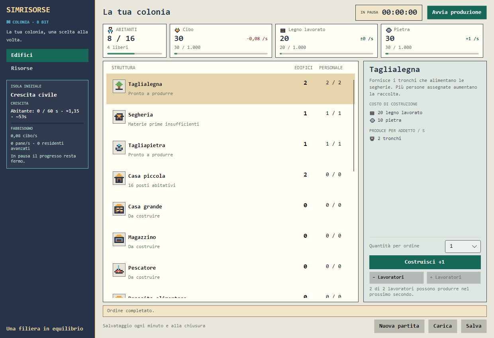

# SimRisorse



Gioco gestionale in cui sviluppi una colonia investendo materiali e lavoratori nelle filiere produttive. Parti da tronchi, legno lavorato e pietra, fai crescere la popolazione e sblocchi alimentazione e industria.

Il progetto è in sviluppo. La prima campagna prevede **22 tipi di edifici**: per vincere occorrerà possederli tutti, costruendo per ultimo il Castello, sbloccato da una conquista obbligatoria. Militari, navi, conquista e vittoria devono ancora essere implementati.

## Stato attuale

**27 ottobre 2026 — M0–M4 completate, M5.1a Ferro e M5.1b Oro verificate su Windows.** Lo scenario corrente è `civil-growth-7`, con **17 tipi di edifici e 14 risorse**.

- Crescita civile con Case piccole e grandi, Cibo e Pane, Magazzini e capacità delle scorte.
- Miniere di ferro, carbone e oro, due fonderie e priorità del Ferro quando il Carbone scarseggia.
- Interfaccia retro con font monospace, icone pixel, menu laterale Edifici/Risorse e card di abitanti e scorte.
- Dettaglio con descrizione, costi in elenco, produzione e consumi. Ordini da **1, 5 o 10** unità; assegnazioni manuali dei lavoratori.
- Pausa, salvataggio manuale e automatico, ripresa senza produzione a gioco chiuso.
- Conversione dei vecchi salvataggi civili con backup dell'originale; formato SQLite v2.

Ultima validazione completa: **206/206 test superati**, build senza avvisi/errori, simulazioni, quattro benchmark e prove native di entrambi gli scenari. Verificati i layout **1040×740 e 1240×850**. [Risultati e limiti della verifica](docs/validation/DESKTOP_UI.md).

Il prossimo incremento è **M5.1c**, confronto di scala e contesa del Carbone. Forgia, Zecca, Caserma, Cantiere e Castello restano futuri; prezzi e contratti militari/navali richiedono le rispettive scelte. Carne fuori dalla prima campagna e demolizione rinviata. L'obiettivo di circa **8 ore** con una strategia efficiente e **32 ore o più** con strategie lente riguarda il gioco completo e non è ancora una durata dimostrata.

## Avvio su Windows

Servono il **.NET SDK 10** indicato in [global.json](global.json) e l'accesso alle sorgenti NuGet per il primo ripristino. Dalla radice del repository:

```powershell
.\validate.cmd
.\run-game.cmd
```

La validazione ripristina i pacchetti con lock, compila, esegue test e simulazioni, pubblica il desktop e ne verifica il ciclo nativo con salvataggi privati. Gli artefatti sono in `.local-cache/m4/`, esclusa da Git. Con una cache completa è disponibile anche il ripristino offline:

```powershell
.\validate.cmd -OfflinePackageSource .local-cache/nuget
```

Il percorso offline non esegue l'audit delle dipendenze. Comandi, benchmark e modalità di verifica sono nella [guida di sviluppo](docs/DEVELOPMENT.md).

## Come si gioca oggi

La partita parte **in pausa** e tenta di riprendere il salvataggio esistente. Dal menu laterale puoi passare tra Edifici e Risorse; le card di abitanti, posti, lavoratori liberi e scorte restano visibili.

Seleziona una struttura per leggere costi, produzione per addetto e secondo, consumi e prerequisiti. Scegli la quantità, costruisci e assegna i lavoratori. Gli ordini sono consentiti anche in pausa; il pulsante **Avvia produzione** fa avanzare la simulazione. L'hover ocra distingue i pulsanti disponibili da quelli disabilitati in grigio.

Le Case piccole offrono **8 posti** e le grandi **32**, con prerequisito Forno. Con spazio e alimentazione disponibili arriva un abitante ogni **60 secondi validi** al ritmo base; le case aggiuntive accelerano gli arrivi fino a **2×**. Tutti consumano Cibo, mentre i residenti oltre la capacità delle Case piccole richiedono anche Pane. La barra Crescita segnala carenze e blocchi. I valori correnti sono regole di sviluppo, non bilanciamento finale.

Il salvataggio avviene ogni minuto e alla chiusura ordinata, oltre al comando manuale. Su Windows la partita civile usa `%LOCALAPPDATA%\SimRisorse\civil-growth.sqlite3`. Il vecchio scenario mantiene il proprio slot ed è disponibile con `run-game.cmd --scenario economy-foundation`. [Formato, conversioni e recupero](docs/SAVE_FORMAT.md).

Per eseguire il motore senza finestre dopo la validazione:

```powershell
dotnet run --project tools/SimRisorse.Simulation -c Release --no-restore -- --scenario civil-growth --strategy gold --seconds 1502
```

I quattro benchmark abitativi e del Pane si possono leggere senza ripetere le simulazioni con `powershell.exe -NoProfile -ExecutionPolicy Bypass -File .\scripts\report-m4.ps1`. [Guida ai risultati](docs/validation/M4_BENCHMARK_READER.md).

## Stack e struttura

**C#/.NET 10, Avalonia 12.1.4/MVVM e SQLite**, con Microsoft.Data.Sqlite 10.0.14. Monolite modulare: il motore resta indipendente dall'interfaccia. Windows è verificato; Linux/macOS e DPI fisici differenti restano da verificare.

| Cartella | Responsabilità |
| --- | --- |
| `src/SimRisorse.Core/` | Stato e regole della simulazione |
| `src/SimRisorse.Application/` | Casi d'uso, scenari e modelli di lettura |
| `src/SimRisorse.Infrastructure/` | Salvataggi SQLite |
| `src/SimRisorse.Desktop/` | Interfaccia Avalonia |
| `tests/` | Test dei quattro livelli |
| `tools/SimRisorse.Simulation/` | Scenari e benchmark senza finestre |
| `experiments/` | Prove separate dalla soluzione principale |
| `docs/` | Design, decisioni, verifiche e screenshot |

## Documentazione

| Documento | Contenuto |
| --- | --- |
| [Indice completo](docs/README.md) | Documentazione corrente, studi e rapporti storici |
| [Game design](docs/GAME_DESIGN.md) | Regole confermate e questioni aperte |
| [Roadmap](docs/ROADMAP.md) | Milestone completate e prossimi incrementi |
| [Handoff](docs/HANDOFF.md) | Punto operativo da cui continuare |
| [Architettura e ADR](docs/ARCHITECTURE.md) | Confini del codice e decisioni tecniche |
| [Sviluppo](docs/DEVELOPMENT.md) | Comandi, convenzioni e verifiche |
| [Salvataggi](docs/SAVE_FORMAT.md) | Formato, backup e compatibilità |
| [Interfaccia retro](docs/PIXEL_ART_UI.md) | Layout, icone, font e stati dei controlli |
| [Ultima verifica dell'interfaccia](docs/validation/DESKTOP_UI.md) | Gate da 206 test, render e limiti |
| [Changelog](CHANGELOG.md) | Modifiche realizzate |

Lo screenshot iniziale è un render dell'applicazione attuale, conservato nel repository. [Provenienza e aggiornamento](docs/screenshots/README.md).

## Licenza

Il repository contiene la GNU Affero General Public License v3 in [LICENSE.txt](LICENSE.txt).
