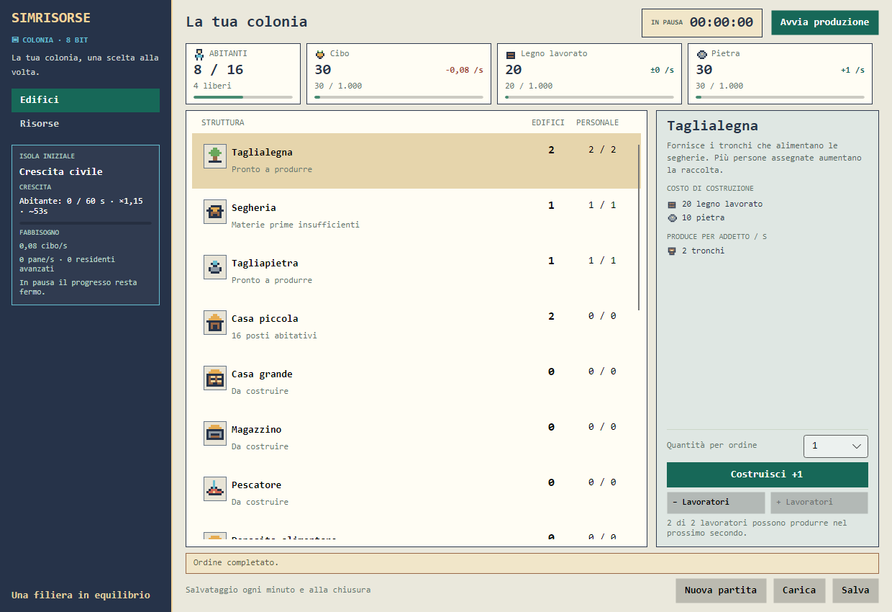
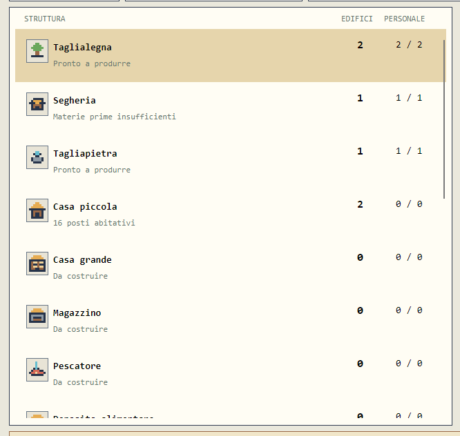
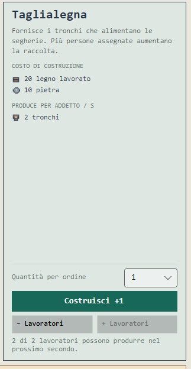

# SimRisorse

Gioco gestionale di risorse, popolazione e filiere produttive in **C# / .NET 10**, con interfaccia desktop pixel art. La città cresce costruendo edifici, assegnando lavoratori, sviluppando la ricerca e mantenendo un equilibrio tra produzione, consumi e capacità di stoccaggio.



*Schermata reale conservata come riferimento visivo. Il layout v15 continua a evolvere: i nuovi filtri Edifici e l'Albero tecnologico sono verificati dai test grafici, ma non sono rappresentati in questa cattura storica.*

### L'interfaccia

| Elenco edifici | Dettaglio della struttura |
| --- | --- |
|  |  |

*I due dettagli sono ritagli della schermata precedente, non screenshot indipendenti. Le catture aggiornate di Edifici, Risorse, Scuola e altri pannelli sono prodotte da `validate.cmd` nella cartella delle evidenze dell'ultima esecuzione.*

### Funzioni principali

- **Edifici e filiere:** livelli Base, Grande, Avanzato; filtri per Alimentazione, Estrazione, Industria, Lavorazioni, Logistica, Abitazioni, Civici e Militari. Gli edifici bloccati sono consultabili.
- **Risorse:** produzione, consumo e saldo; tooltip che ripartiscono i flussi per edificio o attività, sempre nel layout a sette colonne.
- **Scuola e tecnologie:** ricercatori, punti ricerca accumulabili e sblocchi mostrati con icone. Alimentazione I/II sblocca anche i Depositi alimentari Grande/Avanzato.
- **Avvio della partita v15:** Municipio con 120 Legno lavorato, 80 Pietra, 30 Cibo, **100 Carbone e 2 Matite**. Le risorse iniziali non vengono riaccreditate ai caricamenti.
- **Progressione e salvataggi:** crescita demografica e salvataggi SQLite. Le squadre da 10 della Zecca sono ancora opt-in.

La **curva economica A** e il finanziamento progressivo restano **sperimentali**. Il laboratorio usa un database SQLite composito per città, versamenti e ricevute, con backup e ripristino, protezione delle scritture e **identità persistente della campagna (RC103)**, un preflight di migrazione (RC104) e un **prototipo SQLite generation 7 non giocabile (RC105)** con tabelle cittadine e finanziamenti nello stesso file. Questi meccanismi non sono ancora collegati ai salvataggi giocabili; i prezzi e la GUI rimangono invariati.

### Avvio e validazione (Windows, SDK .NET 10)

```powershell
.\run-game.cmd       # Gioca
.\validate.cmd       # Unico comando: build, tutti i test, render, smoke nativo, gate F1 e audit
.\clean.cmd -CacheOnly  # Facoltativo: elimina le vecchie prove locali, non i pacchetti NuGet
```

**L'ultima baseline completamente convalidata è RC95 (1245 test). RC105 resta candidata.** L'esecuzione Windows dell'08/11/2026 dopo il primo hotfix ha compilato e superato **1359 test su 1360**, ma un test Application RC98 è fallito perché la fixture rimuoveva una Fonderia senza aggiornare la capacità del finanziamento. Questo secondo hotfix corregge **soltanto il test** e conserva il controllo che rifiuta checkpoint incoerenti. **Rieseguire ` .\validate.cmd ` su Windows: 1360/1360 e gate F1 non ancora verificati dopo la nuova correzione.** Il gameplay normale non cambia. Tutte le evidenze dell'ultima esecuzione sono disponibili in `.local-cache/m4/`; `validate.cmd` elimina automaticamente le vecchie cartelle `runs` e `f1-gates`, mantenendo l'ultima esecuzione (anche se fallita). La cache NuGet resta intatta.

Il **punteggio delle partite e la classifica locale** saranno sviluppati dopo il consolidamento del gameplay e del bilanciamento. La **classifica online tramite API** è prevista come una delle ultime funzionalità, non in questa release.

### Documentazione

Parti da **[docs/README.md](docs/README.md)**. I riferimenti correnti sono [stato](docs/CURRENT_STATE.md), [roadmap](docs/ROADMAP.md), [decisioni](docs/AUTHORITY_REGISTRY.md) e [handoff per nuova chat](docs/NEW_CHAT_HANDOFF.md). Le decisioni tecniche sono negli [ADR](docs/adr/README.md), la cronologia nel [CHANGELOG](CHANGELOG.md).

*Licenza:* [LICENSE.txt](LICENSE.txt).
