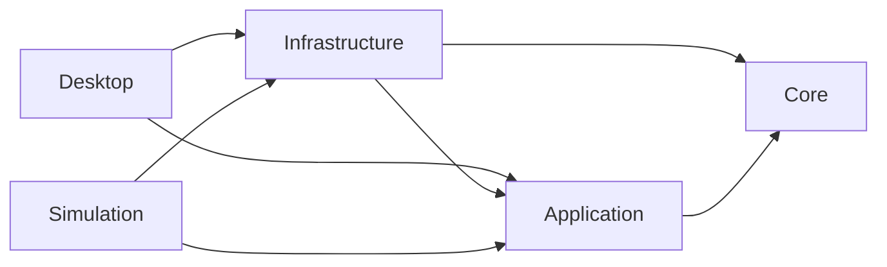

# Architettura

Stato: Core, Application, Infrastructure, Desktop e Simulation implementati e collegati. Le scelte formalizzate sono nel [registro ADR](adr/README.md). Il primo incremento M4 implementa popolazione dinamica, case e filiera alimentare; la progressione militare non è ancora implementata.

Il desktop corrente usa Avalonia 12.1.4 e Microsoft.Data.Sqlite 10.0.14: [ADR 0008](adr/0008-avalonia-12.md). Il nuovo [scenario civile](scenarios/CIVIL_GROWTH.md) usa snapshot/file v2 e uno slot separato, mantenendo quello M3 disponibile in v1: [ADR 0009](adr/0009-civil-growth-and-save-generations.md).

## Impostazione

Un monolite modulare esegue una singola partita locale. Il motore conserva e modifica lo stato in memoria; interfaccia, salvataggi e strumenti di bilanciamento lo usano attraverso confini espliciti.

Le funzionalità applicative sono organizzate per caso d'uso, per esempio `ConstructBuilding`, `AssignWorkers`, `TrainSoldiers`, `SendExpedition`, `SaveGame`. Validazione della richiesta, coordinamento, esito e test della funzionalità restano vicini. Le regole economiche condivise appartengono al motore, senza essere duplicate tra le funzionalità.

Non si introducono microservizi, bus distribuiti o un'infrastruttura completa di event sourcing. Registrare azioni per una futura verifica dei risultati non implica adottare event sourcing per tutto il gioco.

## Confini e dipendenze previste

| Progetto previsto | Responsabilità | Dipendenze interne consentite |
| --- | --- | --- |
| `SimRisorse.Core` | Stato, regole, risorse, popolazione, costruzioni e simulazione | Nessuna |
| `SimRisorse.Application` | Casi d'uso, contratti di salvataggio e proiezioni per la UI | Core |
| `SimRisorse.Infrastructure` | Adattatori per salvataggi e lettura dei contenuti | Application, Core |
| `SimRisorse.Desktop` | Avvio, composizione, viste e stato di presentazione | Application, Infrastructure; Core se necessario per tipi di lettura |
| `SimRisorse.Simulation` | Esecuzione di scenari e strategie senza finestre | Application; Infrastructure per caricare contenuti, Core per ispezione |

Il riferimento Desktop → Infrastructure serve a comporre gli adattatori all'avvio. ViewModel e viste dipendono dai contratti applicativi, senza chiamare direttamente il database. Il Core non conosce XAML, controlli grafici, percorsi su disco, SQL o framework di persistenza.



Il diagramma mostra le dipendenze principali; i riferimenti opzionali di lettura al Core sono descritti in tabella. Ogni modifica alle direzioni ammesse deve essere motivata e verificata durante la creazione della soluzione.

## Organizzazione prevista

```text
src/
  SimRisorse.Core/
    Economy/
    Population/
    Construction/
    Military/
    Expeditions/
    Sessions/
  SimRisorse.Application/
    Features/
      Construction/ConstructBuilding/
      Population/AssignWorkers/
      Sessions/PauseGame/
      Persistence/SaveGame/
  SimRisorse.Infrastructure/
  SimRisorse.Desktop/
tools/
  SimRisorse.Simulation/
tests/
  SimRisorse.Core.Tests/
  SimRisorse.Application.Tests/
  SimRisorse.Infrastructure.Tests/
```

Questo è un piano, non un elenco di cartelle già presenti. Progetti e moduli si creano quando necessari. Le viste possono seguire la stessa suddivisione per funzionalità, senza obbligare il Core a dipendere dall'interfaccia.

La [soluzione attuale](../SimRisorse.slnx) contiene i cinque progetti applicativi e quattro progetti di test. Il dominio dispone di `Content`, `Economy`, `Construction` e `Sessions`; le assegnazioni sono operazioni dell'aggregato, senza introdurre cartelle o classi vuote per i moduli futuri.

## Simulazione

- Il tempo è un input esplicito del motore; leggere `DateTime.Now` dentro una costruzione non è ammesso nella nuova implementazione.
- L'adattatore desktop misura il tempo trascorso durante l'esecuzione; pause, chiusura e sospensione non producono avanzamento da recuperare.
- Il motore stabilisce ordine delle operazioni, arrotondamenti e consumo delle scorte. Queste politiche devono essere definite prima dei relativi algoritmi, non ereditate incidentalmente dall'ordine di un dizionario.
- Interfaccia e salvataggi devono osservare uno stato coerente. `GameRuntime` possiede la sessione e serializza comandi e proiezioni con un lock locale; il Core resta utilizzabile come aggregato a singolo proprietario.
- M2 usa risorse in millesimi su `long`, passo economico di un secondo, tick temporali residui e priorità esplicite. Regole e compromessi sono nell'[ADR 0006](adr/0006-economic-step-and-resource-precision.md).
- Simulazioni lunghe possono procedere senza attese reali, mantenendo le stesse regole e la medesima cronologia delle azioni.

Invarianti da verificare: risorse mai negative, nessun output senza gli input richiesti, nessuna doppia assegnazione delle persone, nessun costo addebitato parzialmente per un acquisto fallito. Una ricetta eseguita e il relativo consumo devono costituire un'unica operazione coerente.

## Contenuti e stato della partita

Una definizione di edificio descrive identificatore stabile, costi, prerequisiti, lavoro, ricette ed effetti. Lo stato della partita descrive quantità possedute, scorte, assegnazioni e avanzamenti. Le due cose non vengono confuse nella stessa classe derivata per ogni edificio.

M4 introduce l'effetto `HousingPerBuilding` e `PopulationRules` opzionali. La sessione possiede popolazione effettiva e secondi di crescita; gli scenari senza queste regole rimangono a popolazione fissa. Un piano civile prenota il cibo prima delle ricette, senza riutilizzare lo spazio liberato nel medesimo passo. Forecast e avanzamento condividono i pianificatori; Application aggiunge consumo civile, fabbisogno e motivi di blocco alle proiezioni.

Il catalogo è versionato e validato: identificatori duplicati, riferimenti mancanti, valori non ammessi e dipendenze irraggiungibili devono emergere prima dell'avvio dello scenario. Il formato dei file, per esempio JSON, resta da scegliere.

M2 verifica riferimenti e cicli dei prerequisiti edilizi. Da M4 `CatalogReachability.Analyze` controlla anche la raggiungibilità economica in modo statico e ottimistico: ogni struttura deve essere costruibile con risorse rinnovabili o con la dotazione iniziale, entro la capacità di base o una capacità ampliabile, e ogni ricetta deve avere input rinnovabili. Il controllo ignora tempo, persone e contesa: dimostra che nessuno sblocco è impossibile, non che la partita sia bilanciata. Non viene imposto nel costruttore dello scenario, perché i test usano cataloghi volutamente bloccati; lo eseguono i test degli scenari distribuiti e la validazione (`--check-catalog`). Il catalogo è costruito in memoria e usa identificatori testuali stabili; non richiede di modificare enum o sottoclassi per aggiungere una ricetta. La versione delle regole viene assegnata esplicitamente, senza fingerprint automatico del contenuto.

Edifici, unità militari, mezzi e missioni possono condividere concetti come costo o requisiti. Mantengono però modelli specifici per il proprio comportamento. L'uso dello stesso controllo grafico non impone una classe base universale.

## Persistenza prevista

Lo stato viene mantenuto in memoria e salvato tramite un contratto applicativo. SQLite è il primo adattatore adottato, non un requisito del Core.

Il salvataggio deve comprendere tempo simulato, risorse, popolazione, costruzioni, attività in corso, versione del formato e identità delle regole. Deve consentire di riprendere senza produrre risorse per il tempo trascorso a programma chiuso.

Formato, atomicità e rifiuto delle versioni non supportate sono definiti per M3 e per lo stato di crescita M4. Sono supportati checkpoint v1 e v2 nel rispettivo scenario; le conversioni tra cataloghi o generazioni restano da introdurre. Non si ricalcola silenziosamente una vecchia partita con un bilanciamento nuovo.

`GameSnapshot` è un contratto immutabile in memoria, con controlli di identità, scorte e assegnazioni e ripresa in pausa. Non coincide con il formato su disco o il salvataggio dell'esperimento. L'adattatore converte esplicitamente dati e quantità e il runtime li valida prima della sostituzione della partita attiva.

M3 implementa questa conversione nel formato SQLite descritto in [SAVE_FORMAT.md](SAVE_FORMAT.md). I casi d'uso `SaveGame` e `LoadGame` usano un port sincrono eseguito fuori dal dispatcher e un gate di persistenza distinto dal lock dello stato. Un contatore di revisione impedisce ai caricamenti tardivi di sostituire sessioni modificate. Le proiezioni vengono aggiornate dallo stato corrente dopo le operazioni asincrone.

Il desktop si compone in `App`: ViewModel e viste non chiamano il driver SQL. Le previsioni di produzione, consumo e saldo al secondo derivano dai lavoratori realmente servibili nel piano condiviso del Core. I dettagli di edifici e risorse sono proiezioni di lettura, non il salvataggio.

Un adattatore monotono sincronizza il tempo prima degli ordini. Pausa, minimizzazione e messaggi di sospensione Windows interrompono la sessione; un lungo intervallo del timer attiva un fallback conservativo. Salvataggi periodici e chiusura ordinata non fanno avanzare il tempo di gioco. Politiche e limiti sono nell'[ADR 0007](adr/0007-desktop-persistence-and-lifecycle.md).

## Risultati e classifica

Il Core rileva il completamento secondo gli obiettivi dello scenario. Il risultato conserva il tempo di gioco e l'identità delle regole usate. Restano da decidere la condizione esatta di vittoria e le categorie della classifica.

Una classifica locale può usare i risultati salvati. Un'eventuale classifica pubblica richiede un modello di verifica separato: un tempo dichiarato dal client non costituisce, da solo, una partita verificata. Server, account e protocolli non sono ancora progettati.

## Transizione dalla bozza

La soluzione storica Windows Forms appartiene alla cartella `legacy/winforms` del repository originario, non inclusa nell'archivio di lavoro corrente. La nuova soluzione non fa riferimento ai progetti legacy.

Si riusano idee e riferimenti di contenuto, verificandone le regole; non si trasferiscono automaticamente l'algoritmo di `Magazzino` o l'orologio per edificio. La sostituzione procede per funzionalità verificabili, iniziando da risorse, costruzioni e lavoratori.

La [prova M1](../experiments/stack-probe/README.md) è isolata in `experiments/stack-probe/`: quattro progetti minimi per modello, persistenza, UI e test. Dimostra lo stack e verifica le regole dello scenario ridotto, ma non definisce le API definitive. La nuova soluzione non deve dipendere dagli assembly dell'esperimento; scenari e comportamenti verificati guidano la loro implementazione nei confini definitivi.
