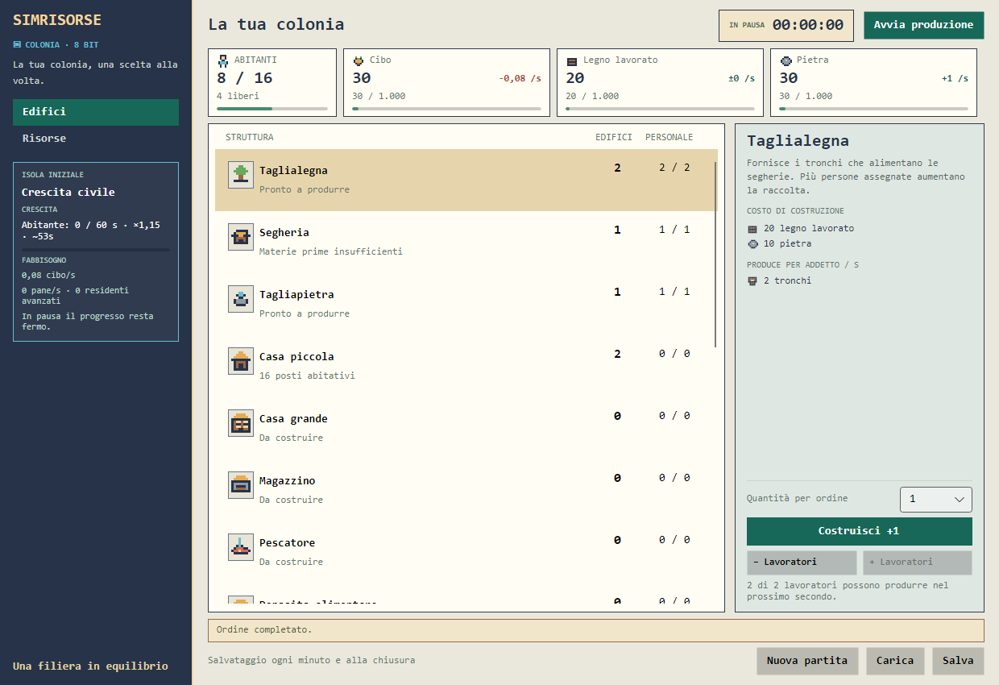

> **RC90.3 — Albero tecnologico:** nella lista delle tecnologie usare la stessa grammatica 8×8 già approvata per le strutture; ogni ramo ha la sua icona coerente. Nel dettaglio, **SBLOCCA EDIFICI** è una lista a righe con icona edificio, nome e tier, non un paragrafo di nomi ripetuti. V14 e V15 allineate. Per Navigazione è aggiunto uno sprite nave 8×8; le tecnologie differite rimangono visibili ma non acquistabili. Nessun cambiamento alle altre colonne, pulsanti e capacità.

> **RC86 — dettaglio costo:** sotto “COSTO DEL PROSSIMO EDIFICIO” visualizzare **solo l’elenco di risorse con icone** (una volta). Non aggiungere la riga testuale ripetuta; conservare layout e preventivi 5/10 separati.

**Nota G1-D19:** questo documento definisce il **contratto storico della GUI v13**, riferimento da preservare integralmente nella sperimentale v14. Le cifre di validazione nelle sezioni storiche non indicano il gate corrente. Per le regressioni v14 e i controlli da completare vedere [matrice di parità](validation/G1_D19_MATRICE_PARITA_GUI.md) e [stato](CURRENT_STATE.md).

---

# Interfaccia retro 8-bit

**Contratto grafico aggiornato al checkpoint documentale v57, 28/10/2026.** La base retro è stata approvata dall'utente nei gate storici; **le estensioni della v55 non sono ancora certificate da un nuovo `validate.cmd` Windows**. La finestra Avalonia usa pittogrammi originali, monospace e pannelli compatti. [Audit v55](validation/V55_STATIC_AUDIT.md), [verifica UI storica](validation/DESKTOP_UI.md), [decisione stilistica](adr/0012-retro-8bit-desktop-visual-language.md).

## Obiettivo

Far leggere subito costi, produzione, lavoratori e motivi di blocco. Il colore accompagna il testo; non sostituisce quantità, unità o spiegazioni. Le strutture si gestiscono da elenco, senza posizionamento su una mappa.

La grafica è sviluppata progressivamente con i contenuti. **La scheda Esercito esiste già** nello scenario civile; navigazione, isole, conquiste, Castello e obiettivo di vittoria arriveranno con incrementi successivi e non devono apparire come funzioni già disponibili.

## Layout attuale

- **Sidebar da 240 px:** marchio, menu Edifici/Risorse e riquadro Crescita civile con progresso e fabbisogni. Il contenuto lungo può scorrere.
- **Testata compatta:** titolo, cronometro, stato e pausa sulla stessa riga.
- **Card comuni alle due pagine:** abitanti/posti, lavoratori liberi e tre scorte principali. Quando ci sono residenti avanzati, il Pane entra nel riepilogo. Le barre di capienza si adattano alla larghezza disponibile.
- **Edifici:** elenco con icona, quantità, personale e stato; dettaglio a destra. Le righe riservano 20 px a destra per non sovrapporsi alla scrollbar verticale.
- **Risorse:** tabella con quantità, capacità, produzione, consumo, saldo al secondo e **«Si riempie tra»** (`hh:mm:ss`), **ordinata alfabeticamente secondo i nomi italiani visibili** (parità risolta dall'ID). Le intestazioni e le celle numeriche sono allineate a destra; solo la quantità in tabella è arrotondata all'unità, lasciando invariati i valori precisi delle card e della simulazione. Lo scorrimento usa il `ListBox` direttamente, con selezione **ocra** della risorsa cliccata, mantenuta al cambiare dei numeri. Anche queste righe hanno 20 px a destra prima della scrollbar. L'ordine del catalogo e le priorità produttive restano invariati.
- **Chiarezza dello stoccaggio (v55):** passa il puntatore sulla **cella Capacità** per vedere quantità esatta, spazio libero e la scomposizione dei bonus. Nello scenario attivo i **1.000 posti per risorsa provengono dal Municipio**, non da una capacità invisibile. Si sommano Magazzini × 500 e capacità locali: produttori +50 per ogni output, case +10/+25 Cibo e Pane, Caserma +20 Spade. Per Pane, Spade e Monete il tooltip indica anche i posti necessari per un lotto indivisibile. Non c'è un riquadro fisso sotto la tabella. Il **Magazzino** amplia tutte le risorse; il **Deposito alimentare** converte Pesce in Cibo e aggiunge solo la capacità locale di Cibo prevista per i produttori.
- **Footer:** messaggi, stato dei salvataggi, nuova partita, caricamento e salvataggio.

Le dimensioni di riferimento sono **1040×740** e **1240×850**. La base ha superato controlli storici; è **ancora richiesta la verifica Windows dell'insieme v55** a entrambe le risoluzioni. Non ridurre i pulsanti o nascondere le diagnosi per guadagnare spazio.

## Dettaglio della struttura

Ordine di lettura:

1. Nome e descrizione.
2. **Costi di costruzione in elenco**, una riga per risorsa, con icona e quantità.
3. **Produzione per addetto e secondo**, con icona della risorsa, quando l'edificio produce.
4. **Consumi per addetto e secondo**, una riga per risorsa con lo stesso formato e pittogramma dei costi e della produzione, quando presenti.
5. **Capacità per edificio** in ogni dettaglio: stoccaggio, alloggi, formazione o nessun incremento, sempre con icona.

I costi seguono la quantità scelta (**+1/+5/+10**); produzione e consumi descrivono sempre il singolo addetto. La capacità descrive **un edificio**. Costi, produzione, consumi e capacità usano lo stesso modello `ResourceDetailTemplate`: testo normale da **12 px**, icona da **14 px**, distanza icona/testo di 7 px.

**Tempo al riempimento:** la GUI calcola `ceil((capacità − quantità esatta) / saldo netto positivo)` in secondi, basandosi sul flusso stimato per il secondo successivo. `00:00:00` significa che la risorsa è già a capacità, `—` che non sta aumentando (o non ha capacità positiva); le ore totali possono superare 24. La stima cambia se intervengono nuove strutture, addetti, consumi, carenze, priorità o limiti dei magazzini. I decimali rimangono nel calcolo anche se Quantità viene mostrata come intero.

Diagnosi, quantità, Costruisci e assegnazioni restano nel fondo fisso. Prerequisiti mancanti e altri avvisi sono visibili sopra i comandi senza scorrere il dettaglio; la descrizione può scorrere quando necessario.

Se una produzione è bloccata dalla capacità, il dettaglio mostra scorta/capienza, posti liberi e posti necessari per un lotto per addetto. Indica esplicitamente la costruzione di un **Magazzino (+500 per ogni risorsa)** come possibile soluzione. Per il **Pane**, i posti iniziali provengono da **Municipio +1.000 e Casa piccola +10**; ciascun Forno costruito aggiunge inoltre **+50 posti di Pane**. Il lotto Forno è **3 unità**. Il Deposito alimentare **non** aumenta il limite del Pane: produce Cibo e aggiunge capacità locale solo a quella risorsa. Sono testi informativi, non nuove regole di produzione.

## Tipografia e pittogrammi

Unica famiglia condivisa `ContentControlThemeFontFamily` in `App.axaml`: **Consolas**, poi **DejaVu Sans Mono, Liberation Mono, Courier New**. Titoli, cifre, tabelle e controlli Fluent usano questa risorsa. Sono font di sistema; non viene distribuito un font aggiuntivo.

`PixelGlyph` disegna matrici originali **8×8** con rettangoli. Il catalogo corrente comprende **21 edifici e 16 risorse**, più l'indicatore degli abitanti; il precedente conteggio v38 (18/15) era una fotografia storica. Le chiavi seguono gli ID del catalogo, più `population` per la card; la grafica resta nel Desktop. La verifica statica v55 copre **38 pittogrammi**, ma l'aspetto effettivo su Windows resta nel gate corrente.

| Utilizzo | Dimensione del controllo |
| --- | ---: |
| Riepilogo risorse e abitanti | 16 × 16 px |
| Tabella Risorse | 20 × 20 px |
| Elenco edifici | 24 × 24 px |
| Costi, produzione, consumi e capacità nel dettaglio | 14 × 14 px |

I pennelli della palette sono immutabili, per consentire l'inizializzazione del tipo anche fuori dal thread UI. I pittogrammi sono codice del progetto; non derivano dagli sprite delle immagini di riferimento. Nessuna dipendenza grafica esterna.

## Palette e stati dei controlli

| Elemento | Colore |
| --- | --- |
| Sfondo principale | `#EAE8DC` |
| Sidebar, testo principale e contorni | `#263349` |
| Riquadro Crescita | `#303B50` |
| Card ed elenco | `#FFFDF4` |
| Dettaglio struttura | `#DFE7E3` |
| Struttura selezionata e hover pulsanti | **`#E6D5AC`**, risorsa condivisa `SelectionBackground` |
| Pulsante primario e menu attivo | `#176858` |
| Costruisci disabilitato / testo | `#B8C2BC` / `#5D6C64` |

L'hover dei pulsanti abilitati usa l'ocra della selezione con testo scuro `#263349` e bordo `#9A6947`. Vale per primari e secondari, compreso il presenter del tema Fluent. I disabilitati restano grigi anche con il puntatore fermo sul controllo. La pressione ha uno stato distinto dall'hover.

**Geometria stabile:** hover, pressione, focus e disabilitazione non cambiano dimensioni, padding o spessore dei bordi. Il pulsante Costruisci mantiene un bordo da 1 px.

## Diagnostica della crescita e della produzione

Le formule e le previsioni provengono da Application. La GUI non ricalcola ricette, priorità, capacità o razioni.

La crescita mostra Cibo, Pane dei residenti avanzati e blocchi. La diagnosi Pane distingue capacità nominale insufficiente, input mancanti, scorte quasi piene e autonomia senza nuove forniture; la descrizione deve restare utile anche senza colori. Se mancano Cibo e Pane insieme, entrambe le necessità sono segnalate.

Le stime nominali della filiera Pane non dimostrano la disponibilità di edifici, addetti o materiali: vedere il [modello di capacità](scenarios/BREAD_CHAIN_CAPACITY.md). Per miniere e fonderie sono esposti prerequisiti, input mancanti, spazio e priorità del Ferro sul Carbone.

## Verifica e rifiniture successive

Il gate **storico** con report dettagliato comprende **206 test**, di cui **48 Desktop**, con render, click sul menu, aggiornamento delle card, ordini multipli, diagnosi fisse e controlli geometrici. Le successive cifre v33/v35 (208/209 casi) sono anch'esse storiche. **Il gate attivo della v55/v57 richiede 287 test xUnit**, non eseguiti qui per assenza di .NET SDK. I test di hover precedentemente confermati controllano colori, contrasto e disabilitazione. [Evidenze precedenti](validation/DESKTOP_UI.md), [audit v55 e checklist Windows](validation/V55_STATIC_AUDIT.md).

Restano da ampliare le prove su DPI fisici, fallback dei font, Linux/macOS, tastiera e accessibilità. Animazioni e nuovi asset si valutano dopo la leggibilità; eventuali bitmap future richiederanno interpolazione adatta al pixel art. Regole economiche e compatibilità dei salvataggi rimangono indipendenti dalle rifiniture visive.

## Tooltip dei flussi — RC89.1

Nella scheda **Risorse**, sulle celle **Produzione /s** e **Consumo /s**, mostrare il dettaglio delle fonti produttive o di consumo effettivamente attive nel prossimo secondo, con numeri di edifici/unità, quantità /s e totale. I flussi devono derivare dalla proiezione del clock e non da ricette nominali. Per il consumo sono incluse le razioni degli abitanti e le trasformazioni alimentari, senza confondere la consegna al deposito con il consumo. **Non** modificare larghezza, ordine, allineamento e scroll delle sette colonne.
