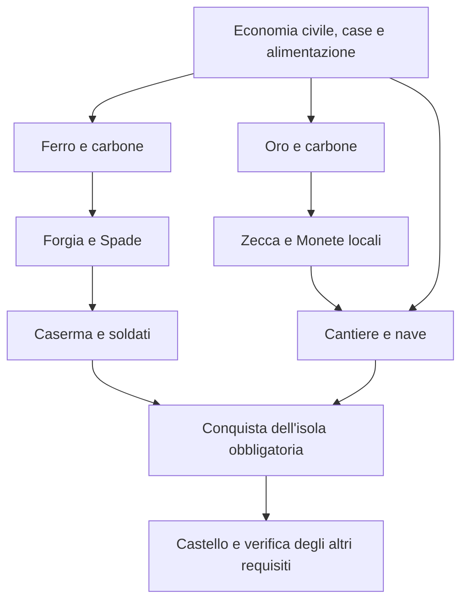

# Prima campagna — catalogo, vittoria e conquista scelti

Data: 2026-10-27. **D0.1, D0.2 e ruolo D0.3 approvati dall'utente.** Prima campagna da 22 tipi; possesso di tutti i tipi e Castello conclusivo; una conquista obbligatoria sblocca il Castello. M5.1a integra i primi tre tipi industriali, con configurazione A e continuità dei salvataggi S1 scelte separatamente. Vittoria e missioni restano funzionalità future.

## Base della proposta

M4 è **chiusa**: gate verificato, benchmark letti, giudizio utente positivo sul prototipo monospace, Carne fuori dalla prima campagna e demolizione rinviata. M5.1a e [M5.1b Oro](../validation/M5_1B_GOLD.md) sono verificate; corrente `civil-growth-7`, **17 tipi di edifici e 14 risorse**, 204/204 test.

Dei [43 riferimenti inventariati](PRE_M5_DECISION_GATE.md), l'utente ha scelto **22 tipi per la prima campagna**: i 12 civili e 10 industriali, militari o navali. Con M5.1b **17 sono implementati e 5 restano futuri**. Gli altri **21 riferimenti sono fuori dalla prima campagna**. Il contratto di vittoria è scelto; le regole operative dei contenuti successivi vanno dimensionate prima dell'implementazione.

Questa scelta preserva l'obiettivo generale di costruire tutti i tipi previsti **dallo scenario scelto**, senza rendere automaticamente obbligatorio ogni elemento delle immagini originali. Un edificio può servire alla progressione oppure essere un traguardo finale esplicito; gli altri entrano nel catalogo quando ne viene definita la funzione.

## Catalogo scelto: 22 tipi

Gli ID dei 17 tipi presenti sono eseguibili; quelli dei cinque tipi futuri sono candidati tecnici. I numeri rimandano alle righe del dossier dei 43 riferimenti.

| Rif. | Tipo | ID presente o candidato | Ruolo proposto | Incremento |
| ---: | --- | --- | --- | --- |
| 01 | Taglialegna | `tree-feller` | Tronchi per la filiera dei materiali | Già presente |
| 02 | Segheria | `sawmill` | Legno lavorato per gli investimenti | Già presente |
| 03 | Tagliapietra | `stonecutter` | Pietra per gli investimenti | Già presente |
| 04 | Magazzino | `warehouse` | Capacità delle scorte | Già presente |
| 07 | Casa piccola | `small-house` | Posti iniziali e bonus di crescita | Già presente |
| 09 | Casa grande | `large-house` | Capienza avanzata e bonus di crescita | Già presente |
| 10 | Fattoria | `farm` | Grano per il Pane | Già presente |
| 11 | Mulino | `mill` | Farina per il Pane | Già presente |
| 12 | Forno | `bakery` | Pane per i residenti avanzati | Già presente |
| 13 | Pozzo | `well` | Acqua per il Pane | Già presente |
| 14 | Pescatore | `fisher` | Pesce per il Cibo | Già presente |
| 17 | Deposito alimentare | `food-store` | Cibo per la popolazione | Già presente |
| 20 | Miniera d'oro | `gold-mine` | Minerale d'oro | M5.1b verificata |
| 21 | Miniera di carbone | `coal-mine` | Carbone per la fonderia | M5.1a verificata |
| 22 | Miniera di ferro | `iron-mine` | Minerale di ferro | M5.1a verificata |
| 23 | Fonderia d'oro | `gold-smelter` | Oro, con futuro impiego nella Zecca | M5.1b verificata |
| 24 | Fonderia di ferro | `iron-smelter` | Ferro, con futuro impiego nella Forgia | M5.1a verificata |
| 25 | Zecca | `mint` | Monete per azioni da definire in D0.8 | M5.2b |
| 26 | Forgia | `forge` | Spade per il reclutamento, contratto D0.8 da scegliere | M5.2a |
| 27 | Caserma | `barracks` | Preparazione dei soldati, secondo D0.4 | M5.3 |
| 30 | Castello | `castle` | Costruzione conclusiva della campagna | M5.7 |
| 31 | Cantiere navale | `shipyard` | Accesso ai mezzi per la prima conquista | M5.4 |

**Quadratura:** 12 civili + 5 estrazione/fusione + 2 Forgia/Zecca + Caserma + Cantiere + Castello = **22**. D0.2 richiede almeno un esemplare di ogni tipo al momento della vittoria. I tipi già forniti all'inizio soddisfano il requisito di possesso; non occorre ricomprarli solo per segnare l'obiettivo.

Le quantità di edifici necessarie a sostenere l'economia possono essere maggiori di uno. I benchmark del Pane dimostrano che il numero di tipi costruiti non misura da solo la capacità produttiva o la disponibilità di persone.

## Gli altri 21 riferimenti

La classificazione approvata con D0.1 è **fuori dalla prima campagna**, non cancellazione definitiva dal progetto. Non sono tipi facoltativi costruibili nel primo catalogo. Un eventuale ingresso futuro richiederà una scelta distinta.

| Rif. | Tipi | Numero | Motivo della proposta |
| --- | --- | ---: | --- |
| 05, 06 | Depositi generali di secondo e terzo taglio | 2 | Il Magazzino attuale è ripetibile; manca una funzione distinta per i livelli |
| 08 | Casa intermedia | 1 | Va dimostrata una scelta distinta da piccola/grande |
| 15, 16 | Cacciatore e Allevamento | 2 | Ruolo della Carne ancora da scegliere |
| 18, 19 | Depositi alimentari di secondo e terzo taglio | 2 | Il Deposito attuale trasforma Pesce in Cibo; i livelli non hanno regole proprie |
| 28, 29 | Sede iniziale e Torre di guardia | 2 | Manca una funzione necessaria distinta da dotazione iniziale, Caserma e Castello |
| 32, 33, 34 | Piantagioni di banane, caffè e cotone | 3 | Commercio coloniale e relative ricompense richiedono un progetto separato |
| 35–43 | Nove strutture decorative dei riferimenti | 9 | Nessun effetto o obbligo di vittoria scelto per la prima campagna |

**Quadratura complessiva:** 22 nel catalogo scelto + 21 fuori = **43**. Soldati, navi, missioni e isole sono entità o stati di progressione, non tipi di edificio aggiunti al conteggio.

## Vittoria scelta: costruzioni presenti e conquista completata

Le risposte esplicite dell'utente adottano questo contratto:

1. Possedere almeno un esemplare di ciascuno dei 22 tipi del catalogo obbligatorio.
2. Aver completato con successo la conquista di **un'isola obbligatoria identificata dallo scenario**.
3. Costruire il Castello, sbloccato da quella conquista, come traguardo conclusivo.

Il Castello fa già parte dei 22: non è un ventitreesimo tipo. Il suo acquisto userebbe materiali ottenibili dalle filiere locali approvate, senza imporre nuove piantagioni o risorse coloniali solo per pagarlo. Materiali, quantità, costi e personale non sono fissati da questa proposta.

Il criterio sarebbe valutato al termine dell'operazione o del passo simulato che completa i requisiti. Il risultato registrerebbe il tempo simulato a quell'istante, escludendo pausa e tempo a programma chiuso secondo i requisiti confermati. Accelerazione, prosecuzione dopo la vittoria e presentazione della classifica restano decisioni D0.5/M6.

### Casi verificabili, prima di scrivere i test

| Caso futuro | Stato | Esito proposto |
| --- | --- | --- |
| 1 | Tutti i 22 tipi presenti, conquista obbligatoria completata, Castello appena costruito | Vittoria al tempo simulato corrente |
| 2 | Gli altri 21 tipi presenti e conquista completata, Castello assente | Partita in corso; costruzione conclusiva ancora da eseguire |
| 3 | Tutti i 22 tipi presenti ma nessuna conquista obbligatoria completata | Nessuna vittoria; un Castello ottenuto da dati incoerenti non sostituisce la conquista |
| 4 | Tutti i tipi sono stati costruiti in passato, ma un tipo obbligatorio è ora assente | Nessuna vittoria; la proposta richiede possesso attuale. Eventuali demolizioni sono una funzionalità separata |
| 5 | Gli altri requisiti sono soddisfatti ma la conquista è in viaggio, fallita o riguarda un'isola diversa | Nessuna vittoria |
| 6 | Tutti i requisiti soddisfatti, nessuna delle 21 strutture fuori catalogo costruita | Vittoria; quei riferimenti non fanno parte di questo scenario |
| 7 | Salvataggio e caricamento dopo una vittoria già registrata | Stesso tempo finale e nessuna duplicazione del risultato |

Questi sono criteri di accettazione del contratto scelto, **non test ancora eseguiti**. Missioni, Castello, demolizione e classifica non sono implementati.

## Percorso strutturale e primo viaggio

Il percorso candidato segue le funzioni dei dossier M5:

Questo diagramma rappresenta una **dipendenza funzionale proposta**, non il grafo completo dei prerequisiti eseguibili. Le frecce non fissano prezzi, consumi o ricette.

Le Monete per il primo mezzo navale devono provenire dalla Zecca locale: la prima nave non può richiedere una risorsa ottenibile soltanto dopo la prima conquista. Analogamente, il Castello non può essere un prerequisito del Cantiere o della missione che deve sbloccarlo. L'identità dell'isola, l'eventuale fase di esplorazione, la forza richiesta e gli esiti di fallimento restano D0.3/D0.4/M5.5–M5.6.

**D0.6 resta aperta:** mancano prezzi definitivi, quantità di soldati, capacità della nave e durate. Il percorso non mostra un ciclo funzionale, ma non dimostra ancora che risorse, scorte e popolazione bastino né che la campagna termini nelle otto ore obiettivo.

## Scelte da registrare separatamente

| Scelta | Proposta concreta | Cosa autorizzerebbe la sua accettazione |
| --- | --- | --- |
| D0.1 — approvata | Catalogo dei 22 tipi, altri 21 fuori dalla prima campagna | Perimetro dei contenuti; non i loro prezzi o le ricette |
| D0.2 — approvata | Possesso dei 22 tipi, con Castello conclusivo; edifici iniziali validi | Contratto degli obiettivi, da implementare nelle fasi future |
| D0.3 — ruolo approvato | Una conquista obbligatoria sblocca il Castello | Ruolo della prima isola; durate, perdite e ricompense restano aperte |

Carne, Cacciatore e Allevamento sono fuori dalla prima campagna; demolizione rinviata e base grafica approvata. **S1 scelta** e **configurazioni A di Ferro e Oro scelte con risposte distinte**. Restano contratti militari/navali, Spade/Monete, tempo del gioco completo, raggiungibilità quantitativa dell'intera campagna e parametri delle filiere successive. L'ipotesi B non è adottata.

**Prossimo incremento:** M5.1c, confronto di scala e domanda condivisa di carbone. Le configurazioni A di Ferro e Oro sono già scelte e verificate nelle regole `civil-growth-7`; parametri e contratti di Forgia/Zecca restano distinti.
