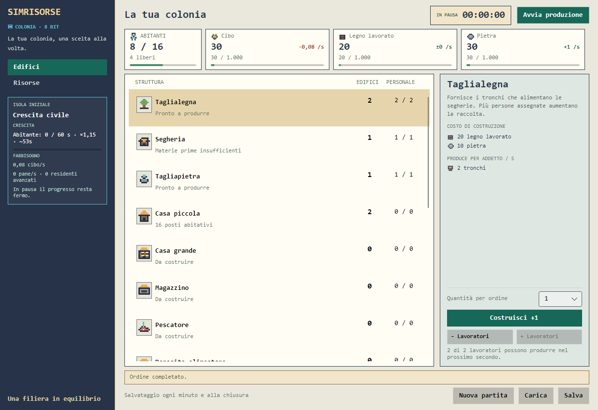

> **E3b/2 (03/11/2026) — NON VALIDATA:** dalla v60-E3b-RC1 confermata verde è stato aggiunto uno store SQLite v3 **isolato**, senza sostituire la sessione o il salvataggio v13. Vedere [G1-D9](checkpoints/G1_D9_CHECKPOINT.md); test Windows ancora necessari.

> **Stato aggiornato G1-D8:** sviluppo sperimentale v60-E3b-RC1 non ancora validato. Snapshot candidato v14 e import da v13 implementati in Core, ma nessuna migrazione SQLite né modifica della campagna corrente. Vedere [checkpoint](checkpoints/G1_D8_CHECKPOINT.md). Ultimo validato: v59-RC1.

> **Stato attuale (03/11/2026):** v60-E3-RC1, prototipo Core non attivo e non ancora compilato; Scuola, ricercatori e tecnologie in sviluppo. La versione giocabile validata resta **v59-RC1 / `civil-growth-13`**. [Come riprendere](checkpoints/G1_D7_CHECKPOINT.md) · [Nota rilascio](releases/V60_E3_CANDIDATE.md).

> **Novità in preparazione (v60-E2-RC1, da validare):** prototipo nel Core di edifici produttivi a tre taglie, migliorie e prezzi progressivi. Non è ancora disponibile in gioco; la campagna v13 e i salvataggi restano invariati. Vedere [checkpoint](checkpoints/G1_D6_CHECKPOINT.md).

> **03/11/2026 — v60-E1-RC1 (candidato):** aggiunti componenti Core isolati e test per prezzi progressivi e ricerca a saldo libero. Nessuna modifica al gioco v13; ultimo gate Windows confermato: v59-RC1. Per dettaglio e verifiche pendenti consultare [G1-D5](checkpoints/G1_D5_CHECKPOINT.md).

> **G1-D4 · 03/11/2026 · SOLO DOCUMENTAZIONE:** approfondito albero tecnologico, settori, Scuola, tempi, controlli anti-softlock, migrazioni e rollout. Regole ancora **PROPOSTE**, nessuna modifica a sorgenti/test/scripts della v59-RC1. [Analisi G1-D4](../design/G1_D4_ALBERO_TECNOLOGICO_E_GAMEPLAY.md) · [ADR 0020](../adr/0020-tech-tree-sector-research-proposta.md).

> **G1-D3 · 03/11/2026 · PROPOSTA NON APPROVATA:** analisi quantitativa di incremento costi per famiglia, tre taglie (1/3/10), upgrade, Scuola, ricercatori e migrazioni SQLite. Nessuna modifica alla v59 eseguibile. [Contratto G1-D3](../design/G1_ECONOMIA_RICERCA_CONTRATTO_QUANTITATIVO.md) · [ADR 0019](../adr/0019-contratto-quantitativo-economia-ricerca-proposta.md).

> **CHECKPOINT 03/11/2026 — v59-G1-D1, SOLA DOCUMENTAZIONE.** La v59-RC1 `civil-growth-13` ha superato `validate.cmd` su Windows secondo l'utente; questo ZIP preserva senza modifiche il codice v59 e aggiunge la proposta [G1 flotta/spedizioni](../design/G1_NAVAL_MISSIONS_DECISION_GATE.md). Prezzi, capacità, durate, numero di soldati e simultaneità non sono ancora approvati. [Stato attivo](../CURRENT_STATE.md), [roadmap](../ROADMAP.md), [registro](../AUTHORITY_REGISTRY.md). Le vecchie intestazioni v58/v57 sotto sono storiche.

> **Versione attuale: v59-RC1 (M5.3c).** La v58-RC5 è stata validata con `validate.cmd` sul Windows dell’utente; questa nuova RC1 aggiunge benchmark e 9 test militari, senza cambiare il gameplay, ed è ancora da testare. Prima leggere [00_START_HERE.md](../START_HERE.md), [stato](../CURRENT_STATE.md) e [roadmap](../ROADMAP.md). La descrizione storica sottostante è conservata per contesto.

> **Versione candidata v58-RC5 · 3 novembre 2026.** Corretto un disallineamento fra benchmark industriali `civil-growth-9` e ruleset attivo `civil-growth-13` nel validatore. Questo pacchetto include progetto completo, C# e documentazione. La fase xUnit RC4 ha consentito di raggiungere i benchmark; **validazione RC5 ancora da eseguire su Windows**. Leggere [rapporto RC5](../validation/V58_RC5_VALIDATOR_VERSION_DRIFT.md) e [stato attuale](../CURRENT_STATE.md). I riferimenti a RC2–RC4 nelle sezioni storiche non definiscono lo stato corrente.

> **Aggiornamento 3 novembre 2026 — v58-RC4, gate Windows R3 aperto.** La RC3 ha compilato con 299 test eseguiti: **296 riusciti e 3 falliti** (Core, Application, Desktop). La RC4 introduce tre interventi mirati e richiede un nuovo `\.\validate.cmd` in una cartella pulita. Per lo stato attendibile consultare [report RC4](../validation/V58_RC4_3_REMAINING_TESTS.md), [CURRENT_STATE](../CURRENT_STATE.md), [ROADMAP](../ROADMAP.md) e [V58_RILASCIO_CANDIDATO](releases/V58_RILASCIO_CANDIDATO.md). I paragrafi precedenti rappresentano checkpoint storici.

> **Aggiornamento 3 novembre 2026 — v58-RC3 (da validare).** Il gate Windows sulla RC2 ha compilato ed eseguito 299 test: 295 superati e 4 falliti. La RC3 corregge queste anomalie; richiede nuovamente `\.\validate.cmd` su Windows. Consultare [report RC3](../validation/V58_RC3_299_TESTS.md), [stato](../CURRENT_STATE.md), [roadmap](../ROADMAP.md) e [rilascio candidato](releases/V58_RILASCIO_CANDIDATO.md). I paragrafi v57 sottostanti sono documentazione storica.

> **Aggiornamento 03/11/2026 · v58-RC2 (non validata):** questo documento contiene materiale del precedente checkpoint v57 e alcune parti sono storiche. Per lo stato attuale del ramo unificato leggere [docs/CURRENT_STATE.md](../CURRENT_STATE.md), [docs/ROADMAP.md](../ROADMAP.md) e [docs/validation/V58_RECONCILIATION.md](../validation/V58_RECONCILIATION.md). Nuovo ruleset candidato: `civil-growth-13` (addestramento individuale); flotta non implementata.

# SimRisorse

**Stato attuale: v58-RC3, `civil-growth-13`, candidato non ancora validato.** Leggere prima [00_START_HERE.md](../START_HERE.md), [stato corrente](../CURRENT_STATE.md), [rapporto dei quattro test RC2](../validation/V58_RC3_299_TESTS.md) e [roadmap](../ROADMAP.md). Il primo gate Windows RC2 ha compilato, con **295 test superati su 299**. Il resto di questa sezione contiene anche cronologia della v57.



Gioco gestionale in cui sviluppi una colonia investendo materiali e lavoratori nelle filiere produttive. Parti da tronchi, legno lavorato e pietra, fai crescere la popolazione e sblocchi alimentazione e industria.

Il progetto è in sviluppo. La prima campagna prevede **22 tipi di edifici**: per vincere occorrerà possederli tutti, costruendo per ultimo il Castello, sbloccato da una conquista obbligatoria. Il reclutamento e l'addestramento sono ora disponibili nell'interfaccia; le navi, la conquista e la vittoria sono ancora da realizzare.

**28 ottobre 2026 — v55, verifica della v54 (regole invariate).** Il Municipio unico, la capacità distribuita e il formato `civil-growth-12` rimangono quelli della v54. Rafforzati i controlli sugli edifici iniziali fissi e il test di doppio caricamento dei salvataggi; nel dettaglio del Municipio non compaiono più i controlli dei lavoratori. **Verifiche statiche completate, `validate.cmd` e 287 test da eseguire su Windows.** [Rapporto v55](../validation/V55_STATIC_AUDIT.md). Il prossimo passo di progettazione è la [decisione M5.4 aggiornata](../design/M5_4_DECISION_GATE_V55.md): le regole delle navi non sono ancora approvate.

## Evoluzione precedente — note storiche

**Attenzione:** i paragrafi v54…v24 sotto conservano le descrizioni formulate all'epoca; alcune contengono «corrente», «ancora da fare» e conteggi di test **superati da versioni successive**. Non usarli per pianificare la nuova chat. La fonte attuale è [CURRENT_STATE.md](../CURRENT_STATE.md), mentre il dettaglio cronologico è nel [changelog](../../CHANGELOG.md).

**28 ottobre 2026 — v54, Municipio e capacità distribuita (da validare).** Scenario attivo **`civil-growth-12`**: un **Municipio unico**, presente dall'inizio e non costruibile, dà significato alle scorte iniziali (120 Tavole, 80 Pietra, 30 Cibo) e offre **+1.000 posti a tutte le risorse**. Il valore di capienza base fuori dagli edifici è ora zero. Ogni edificio produttivo aggiunge **+50 posti alla propria produzione**; Casa piccola **+10 Cibo e Pane**, Casa grande **+25 Cibo e Pane**, Caserma **+20 Spade**; ogni Magazzino continua a dare **+500 per ciascuna risorsa**. Le scorte restano condivise. Il tooltip di Capacità mostra il contributo di tutti gli edifici; il dettaglio Edifici usa le icone delle risorse e non nasconde più le diagnosi dei produttori. Salvataggi `civil-growth-1…-11` aggiornati con un Municipio, senza nuovi materiali e con backup S1. **21 strutture nel catalogo (20 della campagna realizzate + Municipio iniziale esterno ai 22 obiettivi), 16 risorse, 287 test attesi: non eseguiti qui senza .NET SDK.** Cantiere/Flotta restano proposte non approvate, da una futura **`civil-growth-13`**. [Validazione v54](../validation/V54_TOWN_HALL_DISTRIBUTED_STORAGE.md).

**28 ottobre 2026 — v53 (storico), capacità uniforme e dettagli edifici.** Nello scenario precedente **`civil-growth-11`**, ogni risorsa, **Pane compreso**, ha **1.000 unità di capacità iniziale + 500 per Magazzino**. La scheda Risorse mostra il calcolo completo passando il puntatore sul valore di **Capacità**, liberando spazio sotto la tabella. In Edifici ogni struttura mostra **CAPACITÀ PER EDIFICIO** con icona e stesso font di costi, produzioni e consumi: posti abitativi, posti di addestramento, +500 per ogni risorsa oppure nessun aumento. Salvataggi `civil-growth-1…-10` convertiti tramite S1, con backup originale al primo salvataggio; la factory militare v10 resta congelata con il vecchio limite Pane 100, per preservare la verifica dei salvataggi. **20 edifici, 16 risorse, 280 casi xUnit attesi, test Windows v53 ancora da eseguire.** Il contratto navale v51/v52 rimane una proposta **non approvata** e, se accettato, partirebbe dalla successiva **`civil-growth-12`**. [Protocollo v53](../validation/V53_STORAGE_UI.md).

**28 ottobre 2026 — v52, audit tecnico navale.** Aggiunto l'[audit d'integrazione M5.4](../design/M5_4_INTEGRATION_AUDIT_V52.md): il salvataggio SQLite richiede oggi `Military` esplicitamente per v10 sia in lettura sia in scrittura, vincolo da estendere quando la futura flotta arriverà a v11. Mappati i punti di intervento Core/Application/SQLite/Desktop e i test di conversione v10→v11, senza introdurre navi o prezzi nel gioco. **Codice e test restano quelli della v50, 276 test attesi; gate Windows ancora da confermare.** La proposta economica v51 non è ancora approvata.

**28 ottobre 2026 — v51, progettazione M5.4 Cantiere/Flotta.** Preparata una [scheda decisionale](../design/M5_4_DECISION_GATE_V51.md) con un modello navale persistente, prezzi e capienza *proposti*, alternative, analisi della raggiungibilità e test futuri. **Nessuna scelta navale è stata approvata e non è stata modificata alcuna regola di gioco.** Il codice eseguibile rimane quello della v50: `civil-growth-10`, 20 edifici e 16 risorse, **276 test attesi**; il gate completo v50 non è ancora stato riferito superato. Prima di introdurre Cantiere e navi occorrono conferma della validazione v50 e decisione sulle proposte N-01…N-06.

**28 ottobre 2026 — v50, correzione della navigazione militare.** Il log Windows v49 conferma **compilazione riuscita e 275/276 test superati**. Il solo fallimento è `HistoricalFoundationKeepsMilitaryNavigationHidden`: l'elemento `ListBoxItem` non riceve il modello dati della finestra come previsto dal binding `IsVisible`, e la voce Esercito resta visibile nello scenario storico. Ora la visibilità sia della voce sia della scheda è impostata esplicitamente durante l'inizializzazione della finestra in base a `HasMilitaryRules`, senza cambiare la logica di gioco. **276 test attesi**; nuova validazione Windows v50 pendente.

**28 ottobre 2026 — v49, correzione di compilazione della v48.** Risolto **CS0136** in `SqliteGameSaveStore.SaveCore`: la variabile `military` dichiarata in una condizione di validazione aveva un ambito che confliggeva con una seconda variabile omonima più avanti nel metodo. La prima ora si chiama `militaryCandidate`. Nessuna variazione alla logica, alla base dati, alle regole di gioco o ai test: **276 xUnit attesi**, da validare su Windows. [Dettaglio e gate](../validation/M5_3C_MILITARY_DESKTOP.md).

**28 ottobre 2026 — v48, M5.3c preparata.** Aggiunta la scheda **Esercito** al menu laterale per lo scenario `civil-growth-10`: mostra Caserme e posti, Spade, reclute in attesa e in addestramento, soldati pronti, tempo residuo del gruppo e ripartizione degli abitanti tra lavoro e militari. Arruolamento, annullamento delle sole reclute in coda e congedo usano i tre handler applicativi e mostrano spiegazioni operative quando i comandi non sono disponibili. Il dettaglio della **Caserma** e il suo pittogramma sono ora visibili in Edifici. Nessuna modifica al motore, ai prezzi, ai salvataggi SQLite o alla versione di regole v10. **276 casi xUnit attesi (8 nuovi), build e test v48 ancora da eseguire sul Windows dell'utente**. [Gate M5.3c](../validation/M5_3C_MILITARY_DESKTOP.md).

**28 ottobre 2026 — v47, M5.3b preparata.** Scenario attivo `civil-growth-10`: **20 edifici, 16 risorse**. Aggiunta la **Caserma** al catalogo, con addestramento militare in `GameSession` e salvataggio SQLite v2. La popolazione resta unica e consuma le razioni ordinarie. L'utente ha approvato le regole M-01…M-04 su alloggi, alimentazione, congedo/annullamento e assenza di perdite; annullare reclute in attesa restituisce Spade solo quando c'è capienza disponibile. Le conversioni S1 da v9 introducono Caserma vuota e preservano i dati, con backup al primo salvataggio. **268 test xUnit attesi, non ancora eseguiti su Windows**. I benchmark Forgia/Zecca restano sulla factory v9 storica. I pulsanti di arruolamento, congedo e annullamento nella GUI arriveranno in **M5.3c**. [Protocollo di validazione v47](../validation/M5_3B_MILITARY_SESSION_SAVE.md).

**28 ottobre 2026 — v46: primo componente indipendente di M5.3 Caserma/reclutamento, ancora fuori dalla partita giocabile.** L'utente ha confermato i **test v45 passati** e scelto il contratto **Formazione semplice** per la Caserma (280 Tavole/200 Pietra, 2 Spade/recluta, 2 posti e 60 s/gruppo con coda). La v46 aggiunge un modello militare puro e 15 test, **249 casi xUnit attesi**, senza modificare economia, GUI o salvataggi. M0–M4 completate, M5.1a Ferro e M5.1b Oro verificate; M5.2a Forgia/Spade e M5.2b Zecca/Monete implementate. Le v41/v42 aggiungono benchmark di contesa del Carbone e di progressione dalla prima colonia; i relativi dati misurati non sono stati allegati. Lo scenario giocabile resta `civil-growth-9`, con **19 tipi di edifici e 16 risorse**. Il benchmark storico **M5.1c** resta ancorato a `civil-growth-7` e la factory Forgia storica è `civil-growth-8`.

- Crescita civile con Case piccole e grandi, Cibo e Pane, Magazzini e capacità delle scorte.
- Miniere di ferro, carbone e oro, due fonderie e priorità del Ferro quando il Carbone scarseggia.
- **Forgia**: trasforma 1 Ferro e 1 Carbone in 2 Spade per addetto/secondo; le due fonderie hanno precedenza sul Carbone. Le Spade sono consumate all'arruolamento (2 per recluta).
- **Zecca**: trasforma 1 Oro e 1 Carbone in 3 Monete per addetto/secondo, dopo la Forgia nell'ordine di priorita'. Le Monete sono scorte per futuri pagamenti specifici e non vengono richieste per tutte le costruzioni.
- Interfaccia retro con font monospace, icone pixel, menu laterale Edifici/Risorse/Esercito, **tabella delle risorse ordinata alfabeticamente** con stima del tempo di riempimento (`hh:mm:ss`), cifre allineate a destra e quantità arrotondate all'unità. Le card mantengono la precisione precedente.
- Dettaglio con descrizione, costi, produzioni e consumi **in elenchi con icone**. Ordini da **1, 5 o 10** unità; assegnazioni manuali dei lavoratori.
- Pausa, salvataggio manuale e automatico, ripresa senza produzione a gioco chiuso.
- Conversione dei vecchi salvataggi civili con backup dell'originale; formato SQLite v2.

Ultima validazione **completa fino agli smoke e benchmark**, con rapporto dettagliato nell'archivio locale: **206/206 test superati**, build senza avvisi/errori, simulazioni, quattro benchmark e prove native di entrambi gli scenari. Verificati i layout **1040×740 e 1240×850**. Il 28/10 l'utente ha confermato che **i test della v33 sono passati** (208 casi xUnit attesi). Il log Windows v38 mostrava **33 errori su 53 test Desktop** per un pennello statico mutabile condiviso tra thread UI; v39 ha corretto i pennelli. Il tentativo v43 si era fermato in compilazione per `CS8629` e `xUnit1051`; **v44 ha compilato tutti i progetti e superato 232/234 test**, con due fallimenti del test font obsoleto. La v45 ha corretto il test e **l'utente ha dichiarato i test passati, senza allegare il log dettagliato**. [Diagnosi Desktop](../validation/DESKTOP_THREAD_REGRESSION.md), [gate Zecca](../validation/M5_2B_MINT.md) e [verifiche Forgia](../validation/M5_2A_FORGE.md).

Il contratto M5.2 A è stato approvato dall'utente il 28/10; **Forgia e Zecca sono ora implementate**. I confronti **M5.2c** (contesa sintetica del Carbone) e **M5.2d** (progressione dalla colonia iniziale) sono predisposti nel validatore; servono i dati misurati del gate per analizzarli. Il [dossier M5.2](../design/M5_2_FORGE_MINT_PREFEASIBILITY.md) contiene prezzi, ricette e impieghi futuri. Una [prova M5.2 separata](../../experiments/forge-mint-probe/README.md) conserva i profili A/B. Il [contratto M5.3](../design/M5_3_DECISION_GATE_V43.md) ha ora il **modello A approvato**; il [primo Core militare v46](../validation/M5_3A_MILITARY_CORE.md) ne prepara la logica senza introdurre ancora Caserma o soldati nel gioco. Le scelte accessorie su alloggi, razioni, cancellazioni/congedo e perdite restano da prendere. Cantiere e Castello sono futuri; prezzi navali ancora aperti. Carne fuori dalla prima campagna e demolizione rinviata. L'obiettivo di circa **8 ore** con una strategia efficiente e **32 ore o più** con strategie lente riguarda il gioco completo e non è ancora una durata dimostrata.

## Avvio su Windows

Servono il **.NET SDK 10** indicato in [global.json](../../global.json) e l'accesso alle sorgenti NuGet per il primo ripristino. Dalla radice del repository:

```powershell
.\validate.cmd
.\run-game.cmd
```

La validazione ripristina i pacchetti con lock, compila, esegue test e simulazioni, pubblica il desktop e ne verifica il ciclo nativo con salvataggi privati. Gli artefatti sono in `.local-cache/m4/`, esclusa da Git. Con una cache completa è disponibile anche il ripristino offline:

```powershell
.\validate.cmd -OfflinePackageSource .local-cache/nuget
```

Il percorso offline non esegue l'audit delle dipendenze. Comandi, benchmark e modalità di verifica sono nella [guida di sviluppo](../DEVELOPMENT.md).

## Come si gioca oggi

La partita parte **in pausa** e tenta di riprendere il salvataggio esistente. Dal menu laterale puoi passare tra Edifici e Risorse; le card di abitanti, posti, lavoratori liberi e scorte restano visibili.

Nel ruleset candidato **`civil-growth-13`**, dopo aver costruito una **Forgia** e una **Caserma**, apri **Esercito**. Scegli 1, 5 o 10 persone per ordine: arruolare consuma **5 Spade per recluta**. Ogni Caserma ha **1 posto individuale** e forma una recluta in **30 secondi simulati**; le altre aspettano in coda. Reclute e soldati non sono lavoratori disponibili, ma continuano a occupare alloggi e a consumare Cibo e Pane. Puoi annullare sia le reclute in coda sia quelle in formazione, con restituzione delle Spade se la capienza lo consente. Il congedo è **rinviato** in questo ruleset; rimane disponibile soltanto nel ruleset storico `civil-growth-12`. Nel vecchio scenario `economy-foundation` la scheda Esercito non compare.

Seleziona una struttura per leggere costi, produzione per addetto e secondo, consumi e prerequisiti. Scegli la quantità, costruisci e assegna i lavoratori. Gli ordini sono consentiti anche in pausa; il pulsante **Avvia produzione** fa avanzare la simulazione. L'hover ocra distingue i pulsanti disponibili da quelli disabilitati in grigio.

Le Case piccole offrono **8 posti** e le grandi **32**, con prerequisito Forno. Con spazio e alimentazione disponibili arriva un abitante ogni **60 secondi validi** al ritmo base; le case aggiuntive accelerano gli arrivi fino a **2×**. Tutti consumano Cibo, mentre i residenti oltre la capacità delle Case piccole richiedono anche Pane. La barra Crescita segnala carenze e blocchi. I valori correnti sono regole di sviluppo, non bilanciamento finale.

Il salvataggio avviene ogni minuto e alla chiusura ordinata, oltre al comando manuale. Su Windows la partita civile usa `%LOCALAPPDATA%\SimRisorse\civil-growth.sqlite3`. Il vecchio scenario mantiene il proprio slot ed è disponibile con `run-game.cmd --scenario economy-foundation`. [Formato, conversioni e recupero](../SAVE_FORMAT.md).

Per eseguire il motore senza finestre dopo la validazione:

```powershell
dotnet run --project tools/SimRisorse.Simulation -c Release --no-restore -- --scenario civil-growth --strategy gold --seconds 1502
```

I quattro benchmark abitativi e del Pane si possono leggere senza ripetere le simulazioni con `powershell.exe -NoProfile -ExecutionPolicy Bypass -File .\scripts\report-m4.ps1`. M5.1c si esegue con `dotnet run --project tools/SimRisorse.Simulation -c Release -- --benchmark-industry-scale`; il confronto sintetico Forgia/Zecca con `--benchmark-forge-mint-coal`; il percorso dalla prima colonia con `--benchmark-forge-mint-campaign` (sempre sul progetto `tools/SimRisorse.Simulation`). [Guida M4](../validation/M4_BENCHMARK_READER.md); [M5.1c](../validation/M5_1C_INDUSTRY_SCALE.md); [M5.2c](../validation/M5_2C_COAL_BENCHMARK.md); [M5.2d](../validation/M5_2D_REAL_START.md).

## Stack e struttura

**C#/.NET 10, Avalonia 12.1.4/MVVM e SQLite**, con Microsoft.Data.Sqlite 10.0.14. Monolite modulare: il motore resta indipendente dall'interfaccia. La RC3 è in attesa della validazione completa su Windows; Linux/macOS e DPI fisici differenti restano da verificare.

| Cartella | Responsabilità |
| --- | --- |
| `src/SimRisorse.Core/` | Stato e regole della simulazione |
| `src/SimRisorse.Application/` | Casi d'uso, scenari e modelli di lettura |
| `src/SimRisorse.Infrastructure/` | Salvataggi SQLite |
| `src/SimRisorse.Desktop/` | Interfaccia Avalonia |
| `tests/` | Test dei quattro livelli |
| `tools/SimRisorse.Simulation/` | Scenari e benchmark senza finestre |
| `experiments/` | Prove separate dalla soluzione principale |
| `docs/` | Design, decisioni, verifiche e screenshot |

## Documentazione

| Documento | Contenuto |
| --- | --- |
| [Inizio nuova chat](../START_HERE.md) | Ordine di lettura e avvertenze sulla baseline |
| [Stato autorevole](../CURRENT_STATE.md) | Catalogo v55, regole e capacità, test e blocchi attuali |
| [Catalogo esatto](../CATALOG_CURRENT.md) | ID e nomi delle 16 risorse, delle 21 strutture e dei 2 obiettivi mancanti |
| [Handoff completo](../NEW_CHAT_HANDOFF.md) | Decisioni, comandi, roadmap e prossime azioni |
| [Autorità delle fonti](../AUTHORITY_REGISTRY.md) | Quali documenti prevalgono quando i checkpoint storici differiscono |
| [Indice completo](../README.md) | Documentazione corrente, studi e rapporti storici |
| [Game design](../GAME_DESIGN.md) | Regole confermate e questioni aperte |
| [Roadmap](../ROADMAP.md) | Milestone completate e prossimi incrementi |
| [Handoff](../HANDOFF.md) | Punto operativo da cui continuare |
| [Architettura e ADR](../ARCHITECTURE.md) | Confini del codice e decisioni tecniche |
| [Sviluppo](../DEVELOPMENT.md) | Comandi, convenzioni e verifiche |
| [Salvataggi](../SAVE_FORMAT.md) | Formato, backup e compatibilità |
| [Interfaccia retro](../PIXEL_ART_UI.md) | Layout, icone, font e stati dei controlli |
| [Ultima verifica dell'interfaccia](../validation/DESKTOP_UI.md) | Gate da 206 test, render e limiti |
| [M5.1c — benchmark industriale](../validation/M5_1C_INDUSTRY_SCALE.md) | Cinque profili di contesa del Carbone; gate Windows ancora pendente |
| [M5.2a — Forgia e Spade](../validation/M5_2A_FORGE.md) | Nuova versione del catalogo, test previsti e conversione dei salvataggi |
| [M5.2b — Zecca e Monete](../validation/M5_2B_MINT.md) | Regole implementate, test previsti e nuova conversione |
| [M5.2c/d — benchmark](../validation/M5_2D_REAL_START.md) | Dalla colonia iniziale; [contesa sintetica del Carbone](../validation/M5_2C_COAL_BENCHMARK.md) |
| [M5.3 — scheda decisionale v43](../design/M5_3_DECISION_GATE_V43.md) | Modello A approvato; razioni, alloggi, congedo e perdite ancora da decidere |
| [M5.3a — Core militare v46](../validation/M5_3A_MILITARY_CORE.md) | Contratto A scelto, componente isolato, 15 test e piano di integrazione |
| [Changelog](../../CHANGELOG.md) | Modifiche realizzate |

Lo screenshot iniziale è un render dell'applicazione attuale, conservato nel repository. [Provenienza e aggiornamento](../screenshots/README.md).

## Licenza

Il repository contiene la GNU Affero General Public License v3 in [LICENSE.txt](../../LICENSE.txt).
